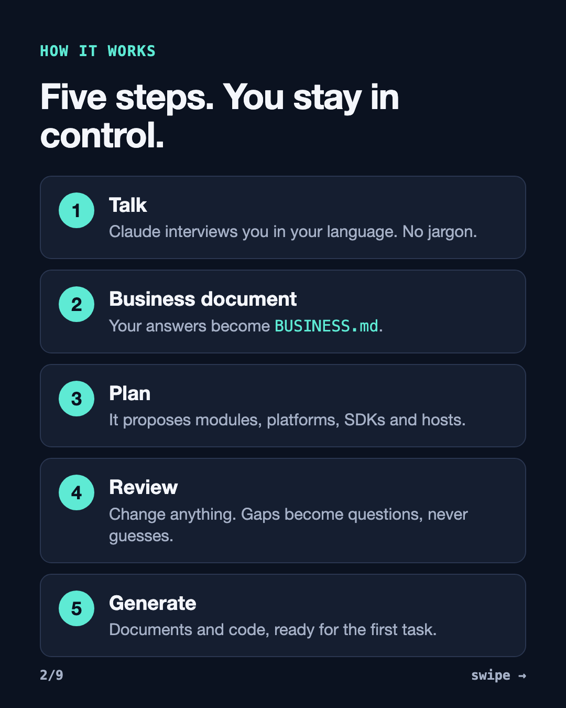
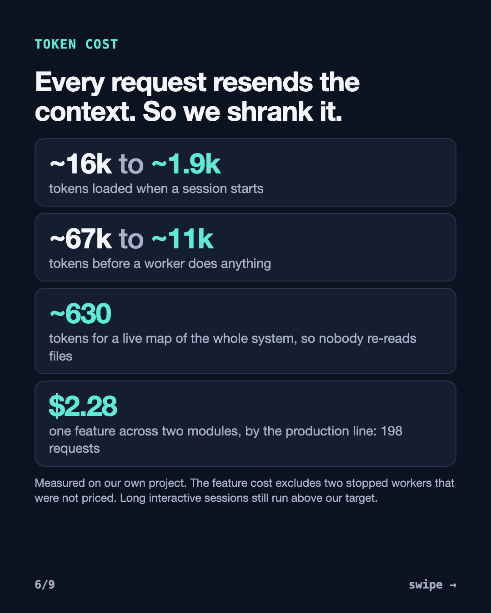

# SYSTEM_SETUP

**Describe your business. Get the whole system.**

One document, in your own language, becomes a reviewed plan, the documents and backlogs of a mature project, and the code to start
building: server, admin panel, web apps, Android and iOS apps, SDKs, CI and deployment files. It packages what we learned building a real
marketplace with AI agents: 9 modules and 500+ finished tasks.



## Quick start

You need Python 3.9+ and, for the steps that use a model, [Claude Code](https://claude.com/claude-code). There is nothing else to install.

```bash
git clone https://github.com/basimJm/system_setup.git
cd system_setup
./SYSTEM_SETUP intake          # Claude interviews you and writes BUSINESS.md
./SYSTEM_SETUP new --business-doc BUSINESS.md --target ../my-system
```

**New to code?** Run those commands, answer in your own words, and approve the plan. Then open the new folder in Claude Code and start
with the first task it names. No Claude Code? Paste `INTAKE_PROMPT.md` into claude.ai and save the result as `BUSINESS.md`.

**Developer?** Everything is data and tests. `./SYSTEM_SETUP new --plan system.plan.json --yes --no-documents` generates with no model at
all. Add a provider, host or module kind by editing `catalog/*.json`. See [docs/REFERENCE.md](docs/REFERENCE.md).

## What you get

| Step | What happens |
|---|---|
| **Intake** | Claude interviews you one question at a time, in your language, with no jargon |
| **Plan** | Your document becomes `system.plan.json`: modules, platforms, SDKs, providers, hosts, open questions |
| **Review** | You can change every choice. Gaps become questions, never guesses. It never asks for a secret value |
| **Documents** | `BUSINESS_DOMAIN.md`; per module a BRD, PRD, Design Script and backlog; `INTEGRATION.md`; a starting API contract. Resumable, with a budget and a printed cost |
| **Code** | Server, admin panel, any number of web and mobile apps, and only the SDKs you need |
| **Update** | `./SYSTEM_SETUP update`: the business changes, the system follows. It only adds, never overwrites, and lists removals for you to decide |

**Nothing is locked in**

- **Platforms** per module: web, Android, iOS.
- **Each SDK:** build it, use your published package and version, or skip it. A new kind of SDK gets a port, a fake adapter and tests.
- **Providers:** ready adapters for FCM, SMTP, HTTP SMS gateways and S3-compatible storage. Any other gets a skeleton, a test that fails until it is built, and a backlog row.
- **Hosting** per part: Render, Docker on a server, AWS, Fly.io, Railway, Cloudflare, Vercel, Netlify or custom.
- **Rules:** every delivery rule is on by default, and you can turn it off or rewrite it. Hooks follow your choice; safety rules ask you to confirm.

## Low token cost, by design

Every request resends the whole context, so cost is requests times context size. Generated projects keep that small.



| What | Before | After |
|---|---|---|
| Tokens loaded at session start | ~16k | ~1.9k |
| Tokens before a worker does anything | ~67k | ~11k |
| A live map of the whole system, so nobody re-reads files | | ~630 |

These were measured on our own project, and every generated project gets the same tools: `scripts/map.py`, `recall.py`, `usage.py`.
One feature across two modules cost $2.28 through the production line (198 requests), not counting two stopped workers we could not price.
Long interactive sessions still run above our target, so keep sessions short.

**The production line** (`scripts/line.py`): a Python script coordinates the work for zero tokens. The API contract is fixed first, so
modules can then work in parallel. Each small, short-lived worker gets only its module and has a budget cap. Scripts check the result
before any model is called, a product review compares the diff with the acceptance criteria, and you decide what merges.

**Real runs of the document step**

| Sample business | Documents | Tasks | Cost | Time |
|---|---|---|---|---|
| Booking marketplace, written in Arabic | 20 | 124 | $3.14 | about 34 min |
| School fee portal, web only | 14 | 79 | $1.74 | about 17 min |

## Lessons that compound

`knowledge/LESSONS.md` holds 169 lessons from real delivery, 26 of them tied to a rule, a check or a template. A new project gets the ones
that match its modules. A finished task can record a lesson, and `./SYSTEM_SETUP lessons import <project>` brings it back to the tool, with
business names removed, after you approve it.

## What it does not do yet

- Generated code is a strong start, not a finished product. The web app starts from the admin shell.
- Adapters were tested against stubs, not live vendors. Hosting configs were checked for structure, not deployed. Each gives you a backlog task for the real proof.
- The server uses MongoDB and Redis. Choosing another database gives a warning and a backlog task, not an automatic switch.
- A system with only staff apps keeps the end-user server code under a neutral name, with a backlog task to remove it. A second app of the same
  role gets a backlog task, not its own server module. The web app's API contract starts as a sample until its first sync.
- No iOS build of a generated app has been run yet.

## Contributing

Pull requests are welcome: see [CONTRIBUTING.md](CONTRIBUTING.md). `main` takes no direct pushes, so every change goes through a PR with
passing checks. Tests: `python3 -m unittest discover -s tests -p 'test_*.py'`. MIT licensed.
